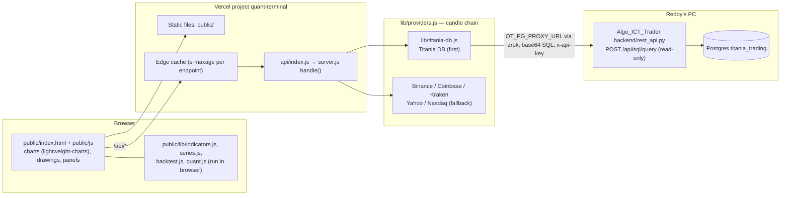
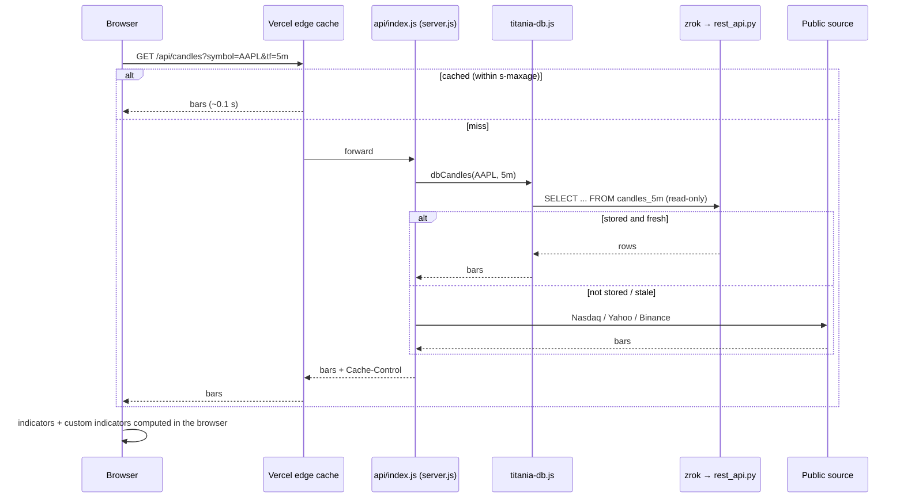

# Quant Terminal (TradingView clone) — Software Architecture

_Last updated 2026-11-04._

Quant Terminal is a browser trading terminal: charts, 50+ built-in indicators, your own custom (Pine-style) JavaScript indicators, drawings, layouts, watchlists, screener, heatmap, strategy tester, bar replay and paper trading. It runs two ways from the same code:

| Mode | How it runs | Saved state | URL |
|---|---|---|---|
| **Local** | `node server.js` (Node 18+, no npm install, no build) | JSON files in `data/` | `http://localhost:3777` |
| **Hosted** | Vercel serverless function (`api/index.js`) + static `public/` | `/tmp` per server instance (temporary) | https://quant-terminal-zeta.vercel.app |

Hosted mode is detected by `process.env.VERCEL` (or `QT_PUBLIC=1`).

## 1. Components



| Path | Role |
|---|---|
| `server.js` | HTTP router (`handle()`), static serving, custom-indicator loader, SSE alerts, access rules, `handleServerless()` for Vercel, `start()` for local |
| `api/index.js` | Vercel entry: restores the original path from `?qtpath=` and calls `handleServerless()` |
| `vercel.json` | Static output `public/`; rewrites `/api/*` and `/custom/*` to the function; bundles `custom/`, `lib/`, `public/lib/`, `seed/` |
| `lib/providers.js` | Symbol resolution (`EXCHANGE:TICKER`), candle/quote/search/screener sources with fallbacks, in-memory cache with in-flight de-duplication |
| `lib/titania-db.js` | Candles from the Titania database through the read-only SQL bridge |
| `lib/feeds.js` | Optional own API keys (Alpaca, Polygon) placed ahead of public sources |
| `lib/store.js` | `read`/`write` JSON state; falls back to bundled `seed/` when nothing is saved |
| `lib/alerts.js` | Alert rules and the background checker (local only) |
| `lib/imports.js` | CSV bar imports and signal → indicator conversion |
| `lib/market-info.js` | News, earnings, dividends, financials |
| `lib/ptq.js` | PTQ connector (read + kill switch; local only) |
| `public/` | The app UI; `public/lib/*` is shared by browser and server (timeframes, resampling, indicators, backtest) |
| `custom/*.js` | Your custom indicators (ICT, LuxAlgo-style, Flux, Sniper, ICT reversal per FX pair, …) |
| `seed/state.json` | Default watchlists, chart indicators, saved layouts, ICT workspace (no drawings) |

## 2. Market data and rate limits

Candle requests go through a chain; the first source that returns bars wins.

| Symbol type | Chain |
|---|---|
| US stocks stored in Titania (Dow 30) | **Titania DB** → own keys → Nasdaq/Yahoo |
| India (`RELIANCE.NS`, `^NSEI`, `^NSEBANK`, NIFTY 50) | **Titania DB** → Yahoo |
| Forex (`EURUSD`) | Titania DB (only if fresh) → Yahoo → Kraken |
| Other US stocks | Own keys → Nasdaq/Yahoo |
| Crypto | Binance (3 hosts) → Coinbase → Kraken |
| Futures (`NQ1!`) | Own Polygon key → Yahoo (delayed) |

**Titania DB provider** (`lib/titania-db.js`):
- Native tables `candles_1m`, `candles_5m`, `candles_30m`, `candles_1h`, `candles_1d`; other timeframes (15m, 4h, 1W, 1M) are resampled from the nearest base.
- The daily table can lag the loaders, so missing recent days are rebuilt from 5m bars.
- Data older than ~4 days is treated as stale and the public chain answers instead (e.g. forex daily).
- The list of stored symbols is cached per instance for an hour. An unstored symbol returns empty and falls through silently.
- Env: `QT_PG_PROXY_URL`, `QT_PG_PROXY_TOKEN` (the bridge token). The bridge connection is read-only with a 60 s statement timeout.

**Why this avoids rate limits:**
1. Most charts used day-to-day come from your own database, not a public API.
2. Hosted responses carry `Cache-Control: public, s-maxage=…, stale-while-revalidate=…`, so Vercel's edge serves one upstream fetch to every visitor and every instance:

| Endpoint | Edge cache |
|---|---|
| `/api/candles` intraday | 30 s |
| `/api/candles` daily+ | 5 min |
| `/api/quotes` | 15 s |
| `/api/search`, `/api/resolve` | 1 h |
| `/api/screener`, calendar, earnings, dividends, news, financials | 10 min |

3. Inside each instance, `cached()` de-duplicates identical in-flight requests.
4. A host that times out is skipped for a minute; Yahoo 429s back off for 10 minutes.

## 3. Hosted-mode rules

- Reads are open; writes need the `x-qt: 1` header and a same-origin request.
- Switched off: saving/deleting custom indicator code (`POST/DELETE /api/custom`), `/api/shutdown`, `/api/ptq/*`. Listing and loading custom indicators still work.
- `/api/events` (live alert stream) returns 204, so the browser stops reconnecting.
- Saved state lives in `/tmp/qt-data` (`QT_DATA_DIR`) and resets when Vercel recycles an instance. A fresh instance opens with `seed/state.json`.
- Background alert checking does not run (no long-running process).

## 4. Deployment

```
cd quant-terminal
vercel deploy --prod --scope sai-teja-reddy-s-projects
```

| Env var (Vercel, production) | Purpose |
|---|---|
| `QT_PG_PROXY_URL` | `https://algoicttraderapi.share.zrok.io` |
| `QT_PG_PROXY_TOKEN` | Bridge API token (same as `ALGO_API_TOKEN` in Algo_ICT_Trader) |
| `QT_DATA_DIR` | `/tmp/qt-data` |

`.vercelignore` keeps `data/`, `output/`, `research/`, `docs/`, `test/`, logs and `.env*` out of the upload.

**Dependency:** the Titania DB path needs your PC on with the Algo_ICT_Trader REST bridge (`scripts/start-rest-api.ps1`) and zrok share (`scripts/start-zrok-share.ps1`) running. If they are down, charts fall back to public sources automatically.

## 5. Data flow — opening a chart



## 6. Risks and limits

1. Titania DB path depends on one PC, the bridge and the zrok tunnel (public sources cover outages, with rate-limit risk).
2. Hosted state is temporary; drawings, layouts and alerts saved on the hosted site can disappear.
3. No authentication — the URL is public (paid Vercel plan planned).
4. Custom indicators run in the browser from bundled files; editing them means a redeploy.
5. Forex daily data in Titania is stale (stops June 2026), so forex charts use Yahoo.
